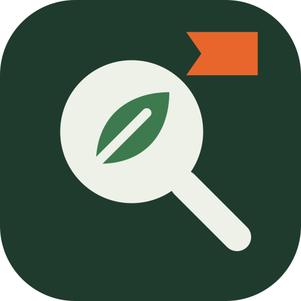

# FieldCall

[](https://opensource.org/license/mit/)



**Paid calls for wildlife sightings. Anyone funds a call; naturalists post on iNaturalist as they always do; GenLayer
validators check each sighting, look at the photos when the call asks for something specific, and pay the observer.**

Conservation work runs on records: where an invasive hornet is nesting, whether hedgehogs still breed in a town, whether a
rare orchid flowered this year. Millions of people already photograph wildlife and post it to
[iNaturalist](https://www.inaturalist.org), where a community identifies every record. But nobody pays for the one record that
matters, and when someone tries (a bounty for nests, a reward for a first county record), every sighting has to be checked by
hand and every payout trusted to whoever holds the money.

FieldCall turns that into a contract:

1. A **sponsor** opens a **call**: an iNaturalist **taxon** (a species, or any genus or family), an iNaturalist **place**, the
   dates sightings must fall between, a **reward per sighting**, and the rules: research grade only, at most N per observer,
   a minimum account age, a location accuracy. Optionally a **photo condition**, in plain words: *"The photo shows a hornet
   nest."* Validators read the taxon and place from iNaturalist and freeze them. **Anyone can add GEN** to a call's pot.
2. **Anyone submits** an iNaturalist observation to a call: their own, or someone else's.
3. **Every validator** reads the observation and the observer's public profile from iNaturalist and checks **in code**: the
   community identification is the call's taxon or below it, quality grade, not captive, the date, the places the observation
   falls inside, location accuracy and account age. If the call has a photo condition, each validator **looks at the photos**
   (up to three, one at a time) and answers `MEETS`, `NOT_MEETS` or `UNCLEAR`; they must agree. They never re-identify the
   species: the iNaturalist community already did.
4. A qualifying sighting reserves the reward **for the wallet address in the observer's iNaturalist profile**, which only the
   observer can edit. Anyone can submit; nobody can redirect the money. An observer who has not linked a wallet yet has the
   reward **held** until the call's collect date; they add a `0x…` address to their profile and anyone presses **Collect**.
5. The side a ruling goes against has **10 minutes** to ask once for a fresh reading (an identification can change). Every
   ruling stores a **plain-English reason**, a **timeline** and an **evidence packet** with sha256 hashes of what was read,
   including each photo looked at. When the call's collect date passes, anyone **closes** it and the rest of the pot returns
   to the funders, in proportion to what each put in.

**Live app:** [fieldcall-bars26.vercel.app](https://fieldcall-bars26.vercel.app). Paste any iNaturalist observation and see,
without a wallet, which open calls it would earn and why. Writes need MetaMask on GenLayer Studio (chain 61999); **Test GEN**
funds your wallet.

**Contract:** [`0x0F8709541c0ae378A2E1a1958032d7CaE3f269Dc`](https://explorer-studio.genlayer.com/address/0x0F8709541c0ae378A2E1a1958032d7CaE3f269Dc) on GenLayer Studio.

## Why GenLayer

- **Looking at the photo.** "The photo shows a nest", "a living hedgehog", "flowers open": the thing a sponsor actually wants
  is in the image, not in any field of the record. Each validator downloads the photo and looks at it; the answer set is fixed
  (`MEETS`, `NOT_MEETS`, `UNCLEAR`) so their agreement is strict. Verified on Studio: a nest photo and a photo of an adult
  hornet on a branch, from the same observer on the same day, get opposite answers.
- **Reading the record.** Every validator queries iNaturalist itself; the identification, the place and the observer's wallet
  are read by each of them, so no single party reports the facts money depends on.

## Verified live, on real iNaturalist records

`scripts/demo.mjs` opened two demo calls with test wallets and submitted real observations of the yellow-legged (Asian) hornet,
*Vespa velutina*, which the UK asks the public to report. Every transaction, reason, evidence packet and the balance
reconciliation are in [`docs/REPRODUCTION.md`](docs/REPRODUCTION.md).

| Call | Observation | Ruling and stored reason |
|---|---|---|
| **Asian hornet nests, UK**, 0.5 GEN, photo condition *"The photo shows a hornet nest"* | [397236824](https://www.inaturalist.org/observations/397236824): a nest in a tree, Romsey, 2026-08-20 | **Qualifies.** Validators looked at the photo and it shows a nest. A co-funder's fresh reading confirmed it. The observer has no wallet in their profile, so the reward is **held for them** |
| same | [397236834](https://www.inaturalist.org/observations/397236834): an adult hornet on a branch, same observer, same day | **Does not qualify**: validators looked at three photos, `NOT_MEETS` each |
| same | [411158753](https://www.inaturalist.org/observations/411158753): a European hornet, the native lookalike | **Does not qualify**: *Vespa crabro* is not *Vespa velutina* (decided in code; the scout's fresh reading agreed) |
| same | [411204951](https://www.inaturalist.org/observations/411204951): an Asian hornet in France | **Does not qualify**: not inside the United Kingdom |
| same | [182971213](https://www.inaturalist.org/observations/182971213): Hull, 2023 | **Does not qualify**: outside the call's dates |
| **Asian hornet sightings, UK**, 0.25 GEN, 2 per observer | three adults by the same observer | **Qualifies, qualifies, then refused**: the observer reached the call's limit of 2 |

Also refused on-chain, with the GEN sent back: a taxon name instead of an id, a taxon and a place iNaturalist does not have, a
call that has already ended, a reward below 0.1 GEN, a pot smaller than one reward. And refused by the contract: submitting an
observation that is already open or already earned its reward, a scout paying out early (only a funder can), collecting a held
reward before the observer links a wallet, and closing a call before its collect date. The contract's balance was reconciled
with `totals()` (open pots plus reserved rewards) at three points of the run, each time after every transfer had finalized.

## Who can do what (and the attacks this blocks)

| Rule | Why |
|---|---|
| The reward goes only to the `0x` address in the **observer's own iNaturalist profile** | Submitting someone else's observation cannot redirect their reward; anyone can submit, nobody can steal |
| Taxonomy is the **iNaturalist community's**: the observation's identification must be the call's taxon or below it | Validators judge the photo condition only; a lookalike species fails in code, not by opinion |
| Research grade, not captive, inside the place, inside the dates, located precisely enough, account old enough: **all in code** | Every validator gets the same answer from the same record; no model judgement where a field decides |
| A photo condition is answered per photo with a fixed answer set; the first photo that clearly shows it decides | Strict consensus on an image judgement; a vague photo is `UNCLEAR` and reserves nothing |
| One payout per observation per call, at most N per observer, and a funder's wallet is never paid by its own call | One prolific account, or the sponsor, cannot drain the pot |
| Only the side a ruling goes against asks for a fresh reading, once each, inside 10 minutes | An identification that changes can still be read; nobody spends the other side's answer |
| Early settlement only against your own interest (a funder pays now, the submitter accepts a refusal) | The submitter cannot rush a payout; funders cannot rush a refusal |
| iNaturalist outages, unreadable profiles and photos are `UNCLEAR`: nothing reserved, submit again | An outage never decides a sighting |
| Held rewards wait until the collect date (call end + 30 days), then return to the pot; the pot returns to funders pro rata | Money never strands; observers who join late still get paid |
| Payable calls never revert; they refund and return `REFUNDED: <reason>` | GenLayer keeps the value of a reverted call |

## The app

- **Would my sighting qualify?** Paste any iNaturalist observation link: the photo, the identification, and for every open call
  the same checks as the contract, ticked or crossed, with the reward it would earn. One click submits it.
- **Every call** shows its taxon and place (linked to iNaturalist), the reward, how much of the pot is paid, reserved and
  free, its terms, a submit box and a fund box.
- **Every sighting** shows the observation's photo with its author's attribution, the ruling and its reason, the window
  countdown with the actions your wallet can take, and **what the validators read**: the facts, the photos they looked at with
  their answer under each, the evidence packet hashes and a link to the GBIF copy of the record.
- **Open a call** with presets (Asian hornet nests, Asian hornet sightings, live hedgehogs) or search any iNaturalist taxon and
  place.
- **Studio's 30 requests per minute:** page loads read the registry server-side with one `get_calls` and one `get_sightings`
  call, CDN-cached; iNaturalist is read straight from the browser.

## Run it

```bash
pip install -r requirements.txt
genvm-lint check contracts/field_call.py
pytest tests/direct/ -v                     # 48 tests: iNaturalist, profiles, photos and the LLM mocked

npm install
node scripts/deploy.mjs
node scripts/verify-code.mjs <address>
node scripts/demo.mjs <address>             # the live run above (about 30 minutes)
node scripts/reproduction.mjs               # regenerate docs/REPRODUCTION.md

cd frontend && cp .env.example .env.local && npm run dev
```

## Limits, stated plainly

- The identification is the iNaturalist community's. A wrong community ID that reaches research grade would pass until someone
  corrects it; that is why funders can ask for a fresh reading, and why calls can require research grade and an account age.
- Validators look at up to three photos. A condition that only a later photo shows may be missed; observers can reorder
  photos. Photos are judged as images: a condition about something not visible (a sound, a smell) cannot be met.
- A wallet in a profile proves control of the iNaturalist account, not who the person is. Per-observer caps and account age
  limit, but do not remove, sock-puppet accounts; research grade still needs other people's identifications.
- The demo calls are funded by test wallets; the observers in the demo have not linked wallets, so their rewards are held and
  will return to the funders.

Observations and photos are © their authors on iNaturalist and are shown with their attribution and licence.

MIT licensed.
