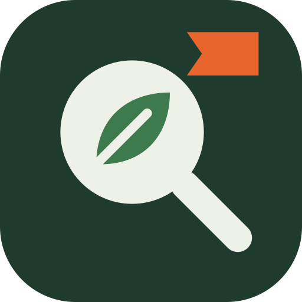

# FieldCall

[](https://opensource.org/license/mit/)



**Paid calls for wildlife sightings. Anyone funds a call; naturalists post on iNaturalist as they always do; GenLayer
validators check each sighting, look at the photos when the call asks for something specific, can require GBIF's copy of the
record to agree, and credit the observer.** Live on GenLayer Studio and on Bradbury testnet, from one source.

Conservation work runs on records: where an invasive hornet is nesting, whether hedgehogs still breed in a town, whether a
rare orchid flowered this year. Millions of people already photograph wildlife and post it to
[iNaturalist](https://www.inaturalist.org), where a community identifies every record. But nobody pays for the one record that
matters, and when someone tries (a bounty for nests, a reward for a first county record), every sighting has to be checked by
hand and every payout trusted to whoever holds the money.

FieldCall turns that into a contract:

1. A **sponsor** opens a **call**: an iNaturalist **taxon** (a species, or any genus or family), an iNaturalist **place**, the
   dates sightings must fall between, a **reward per sighting**, and the rules: research grade only, at most N per observer,
   a minimum account age, a location accuracy. Optionally a **photo condition**, in plain words: *"The photo shows a hornet
   nest."* Optionally **a second source**: GBIF's copy of the record must agree. The call is funded from GEN the sponsor has
   **deposited** first; validators read the taxon and place from iNaturalist and freeze them. **Anyone can add GEN** to a pot.
2. **Anyone submits** an iNaturalist observation to a call: their own, or someone else's.
3. **Every validator** reads the observation and the observer's public profile from iNaturalist and checks **in code**: the
   community identification is the call's taxon or below it, quality grade, not captive, the date, the places the observation
   falls inside, location accuracy and account age. If the call has a photo condition, each validator **looks at the photos**
   (up to three, one at a time) and answers `MEETS`, `NOT_MEETS` or `UNCLEAR`; they must agree. They never re-identify the
   species: the iNaturalist community already did.
4. A qualifying sighting reserves the reward **for the wallet address in the observer's iNaturalist profile**, which only the
   observer can edit. Anyone can submit; nobody can redirect the money. When it is settled the reward is **credited** to that
   wallet, which takes it out with **Withdraw**. An observer who has not linked a wallet yet has the reward **held** until the
   call's collect date; they add a `0x…` address to their profile and anyone presses **Collect**.
5. The side a ruling goes against has **10 minutes** to ask once for a fresh reading (an identification can change). Every
   ruling stores a **plain-English reason**, a **timeline** and an **evidence packet** with sha256 hashes of what was read,
   including each photo looked at. When the call's collect date passes, anyone **closes** it, and anyone can then **return
   each funder's share** of what is left, in proportion to what they put in, one funder per transaction.

**Live app:** [fieldcall-bars26.vercel.app](https://fieldcall-bars26.vercel.app). Paste any iNaturalist observation and see,
without a wallet, which open calls it would earn and why (including GBIF's copy, for calls that require it). The switch at the
top picks the network: GenLayer Studio (chain 61999, **Test GEN** funds your wallet; photo conditions are judged here) or
Bradbury testnet (chain 4221, the GenLayer faucet).

**Contracts (v2):** [`0x1c62070B37C5d040ff4E800eD2B6Bd7C4653A4a7`](https://explorer-studio.genlayer.com/address/0x1c62070B37C5d040ff4E800eD2B6Bd7C4653A4a7) on GenLayer Studio and
[`0xA6280Ed66eF5Ea243DEC2236441Be0588EAFEb0f`](https://explorer-bradbury.genlayer.com/address/0xA6280Ed66eF5Ea243DEC2236441Be0588EAFEb0f) on Bradbury testnet, both checked
byte-identical with their source (`node scripts/verify-code.mjs` / `verify-code-bradbury.mjs`). v1.1 (still live, read-only
for this app) was `0x58576b0a8C0091b8E7E276EDCa9b5D2d9bC826aE`.

## What v2 adds (Milestone)

1. **A second, separately kept source: GBIF.** A call can set `gbif_required`. Then every validator also reads GBIF's copy of
   the observation (GBIF republishes iNaturalist's research-grade records weekly, after its own checks, on its own servers:
   `api.gbif.org/v1/occurrence/search`, dataset *iNaturalist Research-grade Observations*) and requires it to agree with
   iNaturalist on **species and date**, in code. Not published yet: `UNCLEAR`, nothing reserved, read it again later. A
   different species or date: refused. The GBIF record is stored in the sighting's facts and linked from its evidence packet.
2. **No GEN rides on a reading.** In v1 `create_call` was payable *and* asked the validators to look the taxon and place up; a
   GenLayer call whose reading ends undecided keeps the GEN sent with it and applies nothing, so a sponsor's funds could be
   stranded. In v2 a sponsor `deposit`s first and `create_call` takes the funds from that credit only after the validators
   agree; a refused or undecided creation leaves the deposit untouched.
3. **Pull payments.** v1 sent GEN inside `settle`, `collect`, `refund` and refused top-ups. v2 credits every payout (rewards
   to the profile wallet, funders' shares, refused top-ups, unused deposits) and only `withdraw` sends GEN, to the caller. No
   call ever fails, or pays, on someone else's behalf.
4. **Running totals.** `totals()` reads five stored values instead of looping over every call; the unbounded `funding_of`
   view is gone (the registry already returns each call's funders, paged).
5. **Bradbury testnet.** One source for both networks: a short block at the top of `contracts/field_call.py` picks the API of
   the newer py-genlayer runner that Bradbury (Phase 2) runs, and `scripts/bradbury_source.py` writes
   `contracts/field_call.bradbury.py` (the same program with the Bradbury header and without comments, checked by comparing
   syntax trees; Bradbury stores the source on-chain and a block holds about 38 KB). CI lints both files and runs the 63
   direct tests on both runners. The app reads and writes either network, with the fees Bradbury needs (including the
   prepaid message fee of a `withdraw`).

## Why GenLayer

- **Looking at the photo.** "The photo shows a nest", "a living hedgehog", "flowers open": the thing a sponsor actually wants
  is in the image, not in any field of the record. Each validator downloads the photo and looks at it; the answer set is fixed
  (`MEETS`, `NOT_MEETS`, `UNCLEAR`) so their agreement is strict. Verified on Studio: a nest photo and a photo of an adult
  hornet on a branch, from the same observer on the same day, get opposite answers.
- **Reading the record.** Every validator queries iNaturalist itself; the identification, the place and the observer's wallet
  are read by each of them, so no single party reports the facts money depends on.

## Verified live, on real iNaturalist and GBIF records

`scripts/demo.mjs` ran v2 on Studio: three demo calls from test wallets, real observations of the yellow-legged (Asian) hornet,
*Vespa velutina* (which the UK asks the public to report), and of the European hedgehog. `scripts/demo-bradbury.mjs` ran the
same program on Bradbury testnet, where five validators read iNaturalist and GBIF for every ruling. Every transaction, reason,
evidence packet and balance reconciliation is in [`docs/REPRODUCTION.md`](docs/REPRODUCTION.md); the v1 run is kept in
[`docs/v1/`](docs/v1/).

| Call | Observation | Ruling and stored reason |
|---|---|---|
| **Asian hornet nests, UK** (Studio), photo condition *"The photo shows a hornet nest"*, GBIF required | [397236824](https://www.inaturalist.org/observations/397236824): a nest in a tree, Romsey | **Qualifies.** GBIF holds the same record (occurrence 6520319147, same species and date) and validators looked at the photo: a nest. Reward **held** for the observer, who has no wallet in their profile yet |
| same | [397236834](https://www.inaturalist.org/observations/397236834): an adult hornet, same observer, same day | **Does not qualify**: three photos, `NOT_MEETS` each |
| same | [411158753](https://www.inaturalist.org/observations/411158753), [411204951](https://www.inaturalist.org/observations/411204951), [182971213](https://www.inaturalist.org/observations/182971213) | **Do not qualify** (in code): a European hornet, a sighting in France, a sighting from 2023 |
| **Asian hornet sightings, UK** (Studio), 2 per observer | three adults by one observer | **Qualifies, qualifies, then refused**: the observer reached the call's limit |
| **Hedgehogs, UK since 2026-09-01** (Studio), GBIF required | [403107732](https://www.inaturalist.org/observations/403107732), Marlow | **Qualifies**: GBIF occurrence 6566837395 matches |
| same | [414661608](https://www.inaturalist.org/observations/414661608), observed the day before the run | **Unclear, nothing reserved**: GBIF has not published it yet (iNaturalist exports weekly); it can be read again later |
| **Asian hornet sightings, UK (checked against GBIF)** (Bradbury, 5 validators) | [397236834](https://www.inaturalist.org/observations/397236834) | **Qualifies**, 5/5: GBIF occurrence 6519064393 matches; reward held |
| same | [411158753](https://www.inaturalist.org/observations/411158753): a European hornet | **Does not qualify**, 5/5 |

The money path, live: opening a call sends no GEN (it takes the funds from a deposit), and a refused call (unknown taxon, a
start date of 2026-02-31, a pot larger than the deposit) leaves the deposit untouched; a 0.05 GEN top-up is credited back;
the sponsor and a bystander withdrew their credit, and a second withdraw was refused with *Nothing to withdraw*. `totals()`
matched the contract's on-chain balance at six points on Studio and three on Bradbury, each after every transfer had
finalized. Closing and refunding need a call past its collect date, so they are covered by the direct tests (63 tests, run
on both the Studio and the Bradbury runner in CI), including one with 301 funders and 120 refused submissions.

**From the live app with MetaMask, on Bradbury:** a tester deposited 1 GEN and opened a GBIF-checked call from it (the call
itself sent no GEN), submitted a real Asian hornet sighting that five validators ruled eligible against both iNaturalist and
GBIF, had a 0.05 GEN top-up credited back, withdrew it, and settled the sighting after its window. A submission to a photo call
ended without a majority on Bradbury and changed nothing, which is why photo calls are demonstrated on Studio. Transactions in
[`docs/REPRODUCTION.md`](docs/REPRODUCTION.md#wallet-test-from-the-live-app).

## Who can do what (and the attacks this blocks)

| Rule | Why |
|---|---|
| The reward goes only to the `0x` address in the **observer's own iNaturalist profile** | Submitting someone else's observation cannot redirect their reward; anyone can submit, nobody can steal |
| With `gbif_required`, GBIF's own copy of the record must exist and show the same species and date (in code) | A record edited after export, or a mismatch between the two sources, pays nothing |
| A call is funded from a deposit, taken only after the validators agree on the taxon and place; `create_call` is not payable | A reading that ends undecided cannot strand the sponsor's GEN |
| Every payout and refund is credited; only `withdraw` sends GEN, to the caller | No call pays a third party or fails on someone else's behalf |
| Taxonomy is the **iNaturalist community's**: the observation's identification must be the call's taxon or below it | Validators judge the photo condition only; a lookalike species fails in code, not by opinion |
| Research grade, not captive, inside the place, inside the dates, located precisely enough, account old enough: **all in code** | Every validator gets the same answer from the same record; no model judgement where a field decides |
| A photo condition is answered per photo with a fixed answer set; the first photo that clearly shows it decides | Strict consensus on an image judgement; a vague photo is `UNCLEAR` and reserves nothing |
| One payout per observation per call, at most N per observer, and a funder's wallet is never paid by its own call | One prolific account, or the sponsor, cannot drain the pot |
| Only the side a ruling goes against asks for a fresh reading, once each, inside 10 minutes | An identification that changes can still be read; nobody spends the other side's answer |
| Early settlement only against your own interest (a funder pays now, the submitter accepts a refusal) | The submitter cannot rush a payout; funders cannot rush a refusal |
| iNaturalist outages, unreadable profiles and photos are `UNCLEAR`: nothing reserved, submit again | An outage never decides a sighting |
| Held rewards wait until the collect date (call end + 30 days), then return to the pot; the pot returns to funders pro rata | Money never strands; observers who join late still get paid |
| Closing does a fixed amount of work; each funder's share is then returned by its own `refund` transaction, which anyone can send (always to that funder) | No call can grow so large that closing it runs out of gas and strands the funders' GEN |
| Funders, observer counts and submission counts live in their own maps, never in a list on the call; top-ups are at least 0.1 GEN; one observation can be submitted to a call at most 3 times | Spam cannot make any write more expensive than the first one |
| The only payable calls (`fund`, `deposit`) never run a reading; `fund` refuses by crediting the GEN back (`REFUNDED: <reason>`); `create_call` reverts on a bad input, including dates that do not exist (2026-02-31), with the deposit untouched | GenLayer keeps the value of a reverted call |

## The app

- **Would my sighting qualify?** Paste any iNaturalist observation link: the photo, the identification, and for every open call
  the same checks as the contract, ticked or crossed, with the reward it would earn. One click submits it.
- **Every call** shows its taxon and place (linked to iNaturalist), the reward, how much of the pot is paid, reserved and
  free, its terms, a submit box and a fund box.
- **Every sighting** shows the observation's photo with its author's attribution, the ruling and its reason, the window
  countdown with the actions your wallet can take, and **what the validators read**: the facts, the photos they looked at with
  their answer under each, the evidence packet hashes and a link to the GBIF copy of the record.
- **Open a call** with presets (Asian hornet nests, Asian hornet sightings, live hedgehogs) or search any iNaturalist taxon and
  place.
- **Studio's 30 requests per minute:** page loads read the registry server-side with one `get_calls` and one `get_sightings`
  call, CDN-cached; iNaturalist is read straight from the browser.

## Run it

```bash
pip install -r requirements.txt
genvm-lint check contracts/field_call.py
python3 scripts/bradbury_source.py --check  # the Bradbury source is this source with the Bradbury header
genvm-lint check contracts/field_call.bradbury.py
pytest tests/direct/ -v                     # 63 tests: iNaturalist, GBIF, profiles, photos and the LLM mocked

# the same tests under the Bradbury runner (genlayer-test 0.30 reads GenVM Manager v0.6.0-rc10)
pip install "genlayer-test==0.30.0rc2" && FIELDCALL_NETWORK=bradbury pytest tests/direct/ -v

npm install                                 # also patches genlayer-js 2.0 rc for Bradbury fee reads
node scripts/deploy.mjs                     # Studio
node scripts/verify-code.mjs <address>
node scripts/demo.mjs <address>             # the Studio run (about 30 minutes)
node scripts/deploy-bradbury.mjs            # Bradbury (key in ~/.config/genlayer-demos/, from the faucet)
node scripts/verify-code-bradbury.mjs <address>
node scripts/demo-bradbury.mjs <address>    # the Bradbury run
node scripts/reproduction.mjs               # regenerate docs/REPRODUCTION.md

cd frontend && cp .env.example .env.local && npm run dev
```

## Changes in v1.1 (after steward review)

- **Closing cannot be blocked by size.** v1.0's `close()` looped over every sighting and every funder in one transaction, and
  both lists could be padded cheaply. Now `close()` only moves the pot and the expired held rewards into `returnable`; every
  funder is then repaid by `refund(call_id, funder)`, one bounded transaction each, sent by anyone, in any order, with the
  last one taking the rounding remainder. Funders, per-observer counts and submission counts moved out of the call record into
  their own maps, top-ups are at least 0.1 GEN, and an observation can be submitted to a call at most three times.
  `test_stress_hundreds_of_funders_and_refused_sightings_still_close_and_repay_everyone` pads a call with 301 funders and 120
  refused submissions, checks that `close()` reads no sighting and no funder, then repays all 301 and checks every wei left.
- **Impossible dates are refunded.** `create_call` checks that `starts` and `ends` are real calendar dates before any date
  arithmetic, so `2026-02-31` returns `REFUNDED: ...` with the GEN, instead of raising and keeping it; covered by tests that
  record every transfer and by the live run.

## Limits, stated plainly

- GBIF publishes iNaturalist's research-grade records about once a week, so a call that requires GBIF cannot pay for a
  sighting until it is published (it is `UNCLEAR` until then and can be read again). GBIF's copy comes from iNaturalist: it is
  a second, separately kept and checked copy of the same record, not an independent observation.
- On Bradbury, in November 2026, validators often ran out of time on image prompts, so calls with a photo condition are run
  on Studio; calls without one (with or without GBIF) run on both.
- The identification is the iNaturalist community's. A wrong community ID that reaches research grade would pass until someone
  corrects it; that is why funders can ask for a fresh reading, and why calls can require research grade and an account age.
- Validators look at up to three photos. A condition that only a later photo shows may be missed; observers can reorder
  photos. Photos are judged as images: a condition about something not visible (a sound, a smell) cannot be met.
- A wallet in a profile proves control of the iNaturalist account, not who the person is. Per-observer caps and account age
  limit, but do not remove, sock-puppet accounts; research grade still needs other people's identifications.
- The demo calls are funded by test wallets; the observers in the demo have not linked wallets, so their rewards are held and
  will return to the funders.

Observations and photos are © their authors on iNaturalist and are shown with their attribution and licence.

MIT licensed.
